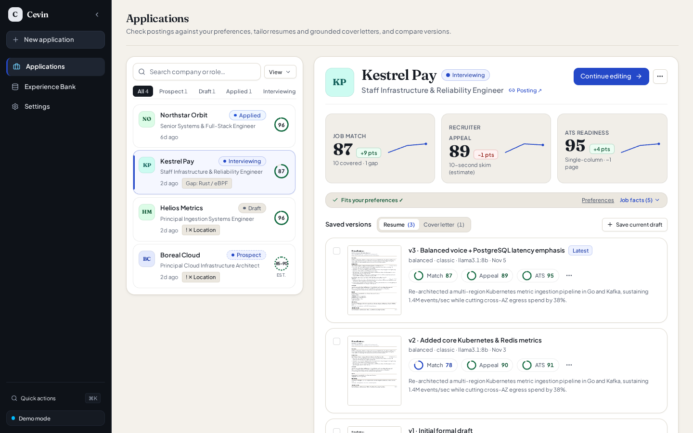

# Cevin — Local-First Resume & Cover Letter Tailoring Studio

## 1. What Cevin Is
Cevin (CV + Kevin: a thoughtful human assistant, not a robot) helps you evaluate job postings and tailor your resume and cover letter from one central **Experience Bank** of verified roles, achievements, and skills. Run a **Quick check** (`⌘N`) on any job posting to inspect **Practical fit** (location, work permits, languages, salary, employment type) and **Coverage** (`Needs attention` gaps/partials vs. `Covered` evidence) before you invest time tailoring. In Studio, shape your prose with a 5-stop **Voice knob**, audit deterministic **Job match**, **Recruiter appeal** (with **Skim view**), **ATS readiness**, and **Letter appeal** (`Checks n/6`), and export clean `First_Last_Company_Resume.pdf`, Markdown, or Plain Text documents. Everything runs locally in your browser against your own LLM (`llama3.1:8b` on Ollama) or built-in Demo mode with zero telemetry.

See [`docs/SCORING.md`](docs/SCORING.md) for a full breakdown of how Job match, Recruiter appeal, ATS readiness, and Practical fit are calculated.



---

## 2. Requirements
- **Option A (Docker, recommended):** Docker Engine with Docker Compose v2.
- **Option B (Local Node.js):** Node.js 20+ and npm.
- **Local LLM (optional for Demo Mode):** [Ollama](https://ollama.com) running locally with at least one 7B–8B instruct model installed.

---

## 3. Quick Start (Docker, Recommended)

```bash
git clone <your-repo-url> cevin
cd cevin
docker compose up -d --build
```

Open **[http://localhost:8080](http://localhost:8080)** in a desktop browser (1024px+ width; designed for 1440px–2560px monitors).

- **Stop Cevin:**
  ```bash
  docker compose down
  ```
- **Update and rebuild after pulling changes:**
  ```bash
  git pull
  docker compose up -d --build
  ```

---

## 4. Run with npm

```bash
npm ci
npm run dev
```

- **Production build & preview on port 8080:**
  ```bash
  npm run build
  npm run preview
  ```

---

## 5. Set Up Ollama

1. **Install Ollama:** Download from [https://ollama.com/download](https://ollama.com/download).
2. **Pull a recommended 7B–8B instruct model and optional embedding model:**
   ```bash
   ollama pull llama3.1:8b
   ollama pull nomic-embed-text
   ```
3. **Verify Ollama is running:**
   ```bash
   curl http://localhost:11434/api/tags
   ```
4. **Configure `OLLAMA_ORIGINS` if your browser blocks cross-origin requests (CORS):**
   - **macOS:**
     ```bash
     launchctl setenv OLLAMA_ORIGINS "http://localhost:8080,http://localhost:3000"
     ```
   - **Linux:**
     ```bash
     OLLAMA_ORIGINS="http://localhost:8080,http://localhost:3000" ollama serve
     ```
5. **Connect in Settings:**
   Open Cevin → **Settings** → select **Ollama (on this computer)** → click **Test connection**, pick your installed model, and save. The bottom sidebar pill will update to `Ollama · llama3.1:8b`.

---

## 6. First-Run Walkthrough in 3 Steps

1. **Connect AI or use Demo mode:** Open **Settings** to test Ollama, or keep **Demo mode (no AI needed)** active.
2. **Add or import your experience:** Open **Experience Bank** and click **Import resume** (`.md` or `.pdf`) to review extracted roles and achievements side-by-side before adding them.
3. **Tailor your resume & cover letter:** Click **+ New application** in the sidebar (`⌘N`), paste the job posting in **1 Job**, edit bullets in **2 Build** (or switch to **Cover letter** → **2 Write**), and export in **3 Review**.

---

## 7. Scripts

| Script | Command | Description |
| :--- | :--- | :--- |
| `npm run dev` | `vite --port=3000 --host=0.0.0.0` | Starts the Vite development server |
| `npm run build` | `vite build` | Builds the production SPA bundle into `dist/` |
| `npm run preview` | `vite preview --port=8080 --host=0.0.0.0` | Serves the production build on port 8080 |
| `npm run typecheck` | `tsc --noEmit` | Runs strict TypeScript typechecking |
| `npm run lint` | `tsc --noEmit && tsx scripts/lint-architecture.ts` | Enforces TypeScript, hexagonal boundaries, single CSS file, no-any, and zero inline styles |
| `npm run test` | `tsx --test src/tests/cevin.test.ts` | Runs domain unit tests, adapter contract suites, E2E smoke test, calibration curves, and UI copy scanner |
| `npm run test:parity` | `tsx scripts/test-parity.ts` | Verifies 100% content, typography, and coordinate parity between `ResumeDocument`/`CoverLetterDocument` and rendered PDF bytes |
| `npm run test:golden` | `tsx scripts/test-golden.ts` | Renders golden PDF rasters across all 3 templates (`classic`, `modern`, `compact`) and asserts `< 0.1%` pixel diff (`-u` updates baselines) |
| `npm run check` | `npm run typecheck && npm run lint && npm run test` | Runs all verification checks in one command |
| `npm run bench:llm` | `tsx scripts/bench-llm.ts` | Runs the golden LLM harness benchmark (20 bullets, 5 JDs, 3 letters) and writes `docs/bench/latest-report.json` |
| `npm run screenshots` | `tsx scripts/capture-screenshots.ts` | Captures light/dark application screens at `1440×900` and `2560×1440` and verifies uncropped textareas and above-the-fold score rows |

---

## 8. Performance on a Laptop (`llama3.1:8b` on Apple Silicon M1 16GB)

Cevin's LLM harness (see [`docs/LLM_HARNESS.md`](docs/LLM_HARNESS.md)) is tuned around **`llama3.1:8b`** as the single default model so it fits comfortably in unified memory (~6.3 GB total with 2 parallel 4,096-token slots):

- **Recommended Ollama Server Environment (macOS)**:
  ```bash
  launchctl setenv OLLAMA_FLASH_ATTENTION 1
  launchctl setenv OLLAMA_KV_CACHE_TYPE q8_0
  launchctl setenv OLLAMA_NUM_PARALLEL 2
  launchctl setenv OLLAMA_MAX_LOADED_MODELS 1
  launchctl setenv OLLAMA_KEEP_ALIVE 30m
  ```
- **In-App Calibration**: Open **Settings → Performance** and click **Tune for my Mac** to measure your machine's reading speed (prefill), writing speed (decode), and GPU/CPU memory split, and automatically pick 1 or 2 parallel slots.

### Troubleshooting Local AI Performance

| Symptom | Cause | Fix |
| :--- | :--- | :--- |
| Sidebar pill shows **`Partly on CPU`** | Model + KV cache exceed available GPU unified memory | Open **Settings → Performance**, set **Parallel requests** to `1`, click **Release model memory**, and enable `OLLAMA_KV_CACHE_TYPE=q8_0`. |
| First bullet takes 6–8 seconds | Cold model weights or cold KV prefix cache | Cevin automatically warms the prefix when you open Studio; keep `OLLAMA_KEEP_ALIVE=30m` so weights stay resident. |
| Browser blocks connection to `localhost:11434` | CORS origin restriction in Ollama | Set `OLLAMA_ORIGINS="http://localhost:8080,http://localhost:3000"` and restart Ollama. |
| Bullet shows **`Original wording kept`** badge | LLM output failed a truthfulness validator twice (e.g., altered a metric) | Cevin protected your resume by keeping your verified Bank wording. Click **Rewrite** or edit the bullet inline. |

---

## 9. True WYSIWYG, Scalable Job Facts & Privacy ("Desk, Paper & Ink")
- **True WYSIWYG ("The preview is the PDF"):** A single domain mapper (`mapToResumeDocument` / `mapToCoverLetterDocument`) feeds the embedded-font PDF engine (`Plus Jakarta Sans` + `Fraunces` static TrueType subsets). `PdfPreview` renders the exact `Uint8Array` PDF bytes onto `<canvas>` via `pdfjs-dist` with an SVG `PreviewOverlay` for Skim view, keyword cross-highlighting, and hovered-bullet bounding boxes (`locateBlocks`). Clicking **Export PDF** downloads those exact bytes (`PDF · 1 page · 48 KB`).
- **Scalable Job Facts Hierarchy:** `FACT_KIND_REGISTRY` and `deriveSalience(status, importance)` enforce strict attention budgets per surface: at most 1 `AttentionToken` on list rows, Score row always first on Applications detail followed by a 1-line `FitStrip`, and a dense `JobFactsTable` on Job/Quick check/expanded views so even 15+ facts never push scores below the fold.
- **100% Local Client-Browser Storage:** All Experience Bank items, job descriptions, applications, saved resume/cover-letter versions (including stored `pdfBytes`), and cached LLM results stay inside your browser's local IndexedDB (`cevin_local_studio_db`, schema v4 via Dexie). Nothing is ever uploaded to an external database or server. Released under the Apache-2.0 License.


