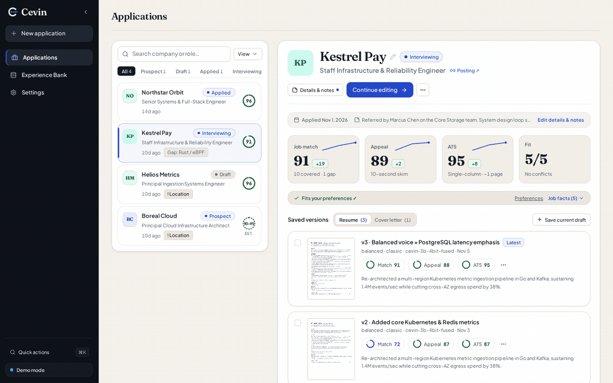
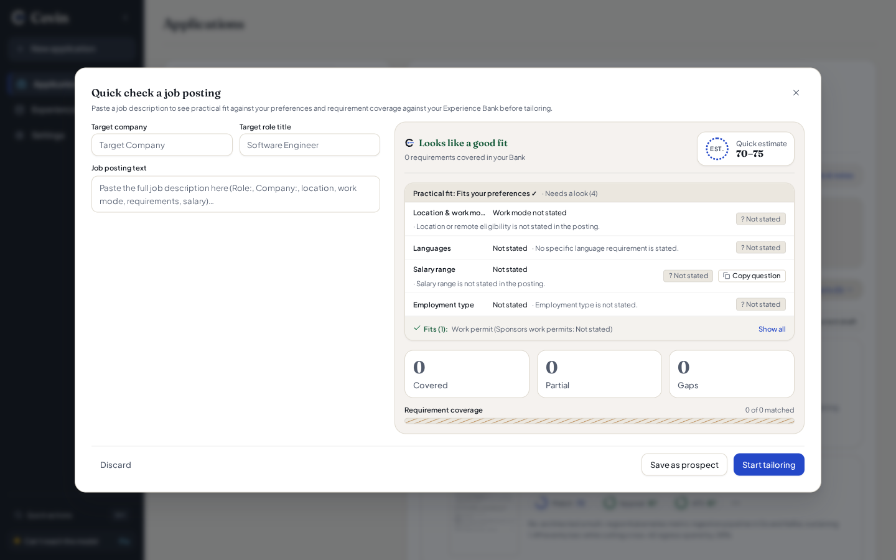
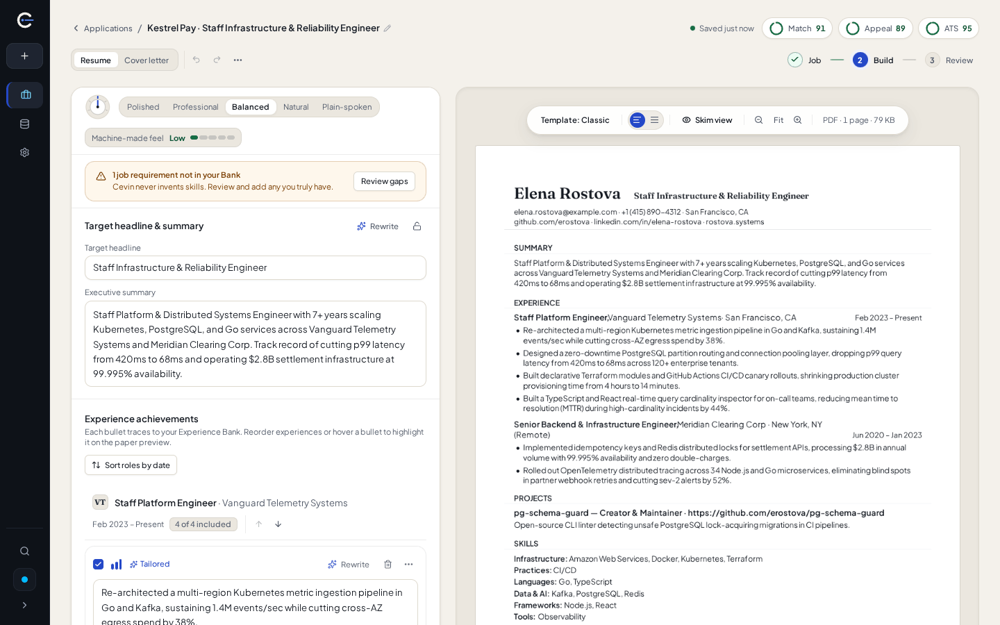
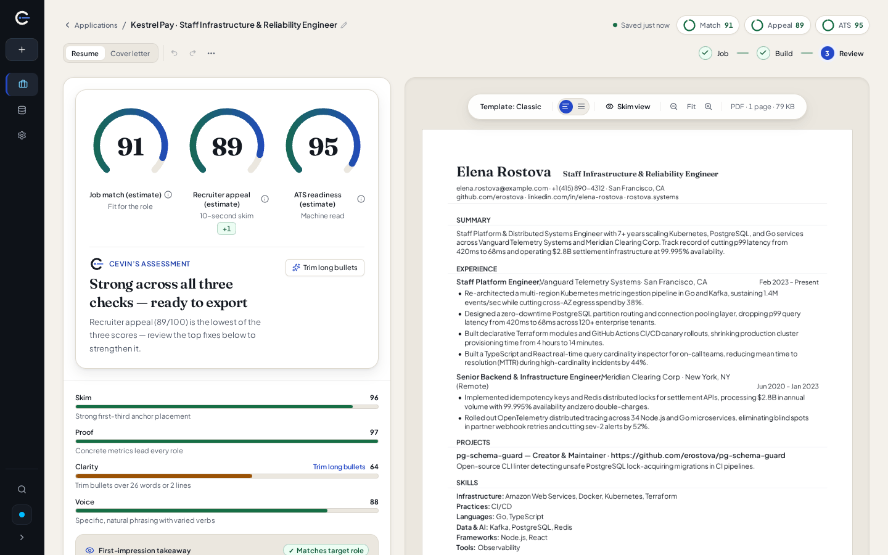
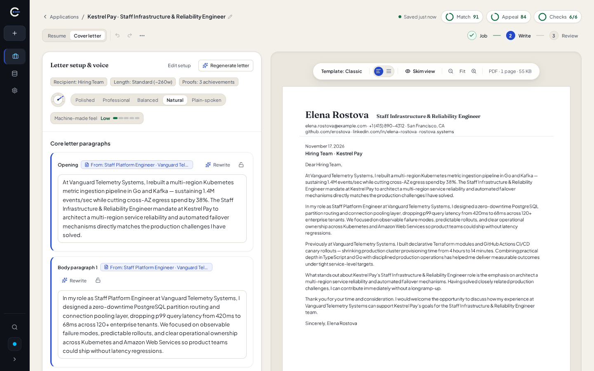
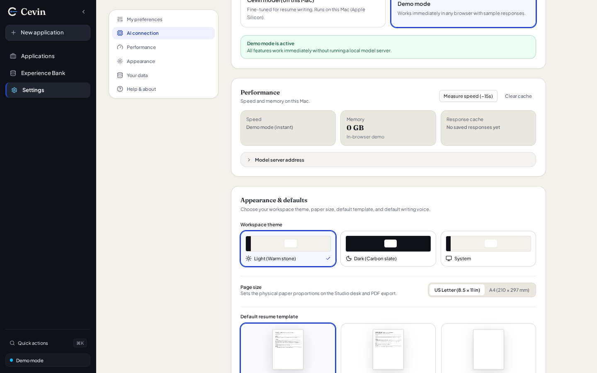

<h1 align="center">
  <picture>
    <source media="(prefers-color-scheme: dark)" srcset="docs/assets/logo-dark.svg" />
    <source media="(prefers-color-scheme: light)" srcset="docs/assets/logo-light.svg" />
    
  </picture>
</h1>

  <strong>Tailor your resume and cover letter to every job using only your real experience.</strong> 
  Import your resume once, check postings against your preferences, and export exact local PDFs.

  
  
  

  <a href="#try-it">Try it</a> ·
  <a href="#what-you-get">Features</a> ·
  <a href="#how-it-works">How it works</a> ·
  <a href="#docs-index">Docs</a>

  

## Why Cevin

Every job posting asks for a slightly different resume.
Copying files by hand is slow and causes drift.
Cloud AI tools can invent claims and upload your career history.

- **Truthful by construction:** Every line traces back to your **Experience Bank** (your verified work record). Unverified claims are flagged.
- **Private:** Your documents stay in browser storage. Local AI runs on your Mac with zero telemetry.
- **Know before you tailor:** **Quick check** (fast job triage) tests postings against your preferences before you edit.
- **Honest scores:** **Job match**, **Recruiter appeal**, and **ATS readiness** provide clear estimates with plain explanations.
- **Exact export:** The live preview is the PDF. Word, Markdown, and plain text exports are also included.

## What you get

### 1. Know before you tailor
Run a **Quick check** (`⌘N`) on any job posting before writing a word.
**Practical fit** checks location, work permits, languages, salary, and job type against your preferences.

### 2. Tailor from your Experience Bank, nothing invented
Edit bullets backed strictly by achievements in your Experience Bank.
Adjust **Voice** (a five-step tone dial from Polished to Plain-spoken) while keeping numbers intact.

### 3. See how it reads
Inspect three estimate scores: **Job match** (role fit), **Recruiter appeal** (10-second skim), and **ATS readiness** (machine readability).
Toggle **Skim view** to highlight the anchors a fast reader sees first.

### 4. Cover letters grounded in your experience and the posting
Draft focused cover letters anchored to real achievements from your Experience Bank.
Audit openings, proof, and length across six built-in checks.

### 5. Export exactly what you see
The preview renders the actual PDF pages you download.
Export PDF, Word (`.docx`), Markdown, or plain text with matching structure and saved versions.

### 6. Private by design
All resumes, job postings, and saved versions remain inside your browser.
Switch between **Demo mode** and your local Mac model server inside Settings.

## How it works

1. Import your PDF or Markdown resume into your Experience Bank and review roles.
2. Press `⌘N` to paste a job posting and check Practical fit and gaps.
3. Tailor bullets and your cover letter in Studio with verified achievements.
4. Review your estimate scores and export PDF, Word, Markdown, or text.

## Try it

### Path A: Demo mode (about 2 minutes, any OS)
Demo mode runs in your browser with sample data and canned AI responses.
It lets you explore the workflow without personal resume files or live AI tailoring.

- **Docker (recommended):** Run `docker compose up -d --build` and open [http://localhost:8080](http://localhost:8080).
- **Local Node.js:** Run `npm ci && npm run dev` and open [http://localhost:3000](http://localhost:3000).

### Path B: Full AI on Apple Silicon

| Requirement | Minimum for Live AI | Notes |
| :--- | :--- | :--- |
| Web app runtime | Docker or Node 20+ | Serves browser UI on port `8080` or `3000` |
| Hardware | Apple Silicon Mac (8 GB+ RAM) | Linux containers cannot access Metal acceleration |
| Python runtime | Python 3.10+ (`mlx-lm`, `fastapi`, `uvicorn`) | Runs natively on your host Mac |

**Path B1 — Public 4-bit model (works out of the box):**
1. Create a virtual environment: `python3 -m venv .venv && source .venv/bin/activate`
2. Install server packages: `pip install mlx-lm fastapi uvicorn pydantic`
3. Start the server: `CEVIN_MODEL_PATH=mlx-community/Qwen2.5-1.5B-Instruct-4bit uvicorn mlx_server:app --host 127.0.0.1 --port 8000`
4. Verify readiness: `curl http://localhost:8000/v1/models`
5. Open **Settings → AI connection** and select **Cevin model (on this Mac)**.

Quality is lower than the fine-tuned model, and Cevin's validators and fallback keep output safe.

**Path B2 — Fine-tuned Cevin models:**
Weights are not public yet. The fine-tuned Cevin weights and training data are not public.
Request access: `[owner contact / request link placeholder]`.
If you have `./cevin-1.5b-4bit-fused` or `./cevin-3b-4bit-fused`, place them in the repo root and start `uvicorn mlx_server:app --host 127.0.0.1 --port 8000`.

**Top 3 troubleshooting checks:**
1. **`Can't reach the model`:** Start `mlx_server.py` on port `8000` on your Mac, then click **Test connection**.
2. **`Model not loaded` without private folders:** Launch with `CEVIN_MODEL_PATH=mlx-community/Qwen2.5-1.5B-Instruct-4bit`, or use Demo mode.
3. **`Original wording kept`:** Safety checks blocked an invented metric or tool. Click **Rewrite** or edit inline.

See [`docs/TROUBLESHOOTING.md`](docs/TROUBLESHOOTING.md) for all fixes.

## Your data stays yours

- **Local browser storage:** Experience Bank items, job postings, and saved versions stay inside browser IndexedDB.
- **Single local endpoint:** Network calls go only to your Mac model server (`127.0.0.1:8000`).
- **Zero telemetry:** Cevin includes no analytics, crash reporters, or third-party trackers.
- **Backup and delete:** Export or restore JSON backups anytime, or erase all data in Settings.

**Verify it yourself:** Open your browser's Network tab while editing; zero requests leave your computer.

## Models

| Model | Unified Memory | Default | Availability | When to choose |
| :--- | :--- | :--- | :--- | :--- |
| Public Qwen2.5 1.5B (4-bit) | ~1.2 GB | Public fallback | Public | Run live local AI without private weights |
| `Cevin 1.5B` | ~1.2 GB | Yes | Private | Fast everyday tailoring on 8 GB+ Macs |
| `Cevin 3B` | ~2.7 GB | No | Private | Higher-capacity option on 16 GB+ Macs |

See [`docs/MODELS.md`](docs/MODELS.md) for full model cards and [`docs/DATASET.md`](docs/DATASET.md) for the schema.
App code and 1.5B base weights use Apache-2.0; 3B base weights follow the Qwen Research License.

## Limits

- The fine-tuned Cevin weights and training data are not public.
- Live local AI requires an Apple Silicon Mac; Windows and Linux use Demo mode.
- **Job match**, **Recruiter appeal**, and **ATS readiness** are heuristic estimates, never hiring guarantees.
- Automated Quick check job-fact rules currently support English and French postings.
- The workspace requires a desktop screen (`1024px` or wider; `1440px`–`2560px` recommended).
- Public un-tuned base weights trigger `"Original wording kept"` fallbacks more often than fine-tuned weights.

## FAQ

**Does my data leave my computer?**
No. All storage is local to your browser, and AI inference runs on your Mac.

**Which model does it use?**
Cevin works with a local MLX instruct model. The fine-tuned Cevin models improve results.
The fine-tuned Cevin weights and training data are not public.

**Which Macs work?**
Any Apple Silicon Mac (`M1` or newer). Eight gigabytes works for 1.5B; 16 GB suits 3B.

**Can I use it on Windows or Linux?**
Yes, in **Demo mode** via Docker or Node.js. Live local AI needs macOS Apple Silicon.

**Will this get me interviews or higher ATS scores?**
No tool can promise hiring outcomes. Scores are transparent estimates highlighting missing skills and clarity fixes.

**How are the scores calculated?**
Every calculation runs deterministically in your browser. Read the formulas in [`docs/SCORING.md`](docs/SCORING.md).

## Docs index

- [`docs/SCORING.md`](docs/SCORING.md) — Score formulas, Practical fit rules, and six letter checks
- [`docs/MODELS.md`](docs/MODELS.md) — Model cards, licenses, and memory behavior
- [`docs/TRAINING.md`](docs/TRAINING.md) — Fine-tuning setup and smoke-test instructions
- [`docs/DATASET.md`](docs/DATASET.md) — Training schema and 50-example synthetic sample dataset
- [`docs/TROUBLESHOOTING.md`](docs/TROUBLESHOOTING.md) — Docker, model connection, and export troubleshooting
- [`docs/ARCHITECTURE.md`](docs/ARCHITECTURE.md) — Code layers and single-pipeline PDF engine
- [`docs/LLM_HARNESS.md`](docs/LLM_HARNESS.md) — Prompt routing, validators, and deterministic fallbacks
- [`docs/EXTENDING.md`](docs/EXTENDING.md) — Adding importers, exporters, templates, and tasks
- [`docs/DESIGN_SYSTEM.md`](docs/DESIGN_SYSTEM.md) — Visual tokens, typography, and component specimens

## Contributing, license & acknowledgements

Contributions are welcome; please read [`CONTRIBUTING.md`](CONTRIBUTING.md) first.
Released under the [Apache-2.0 License](LICENSE). Built with Qwen2.5, Apple MLX, React, TypeScript, and PDF.js.
